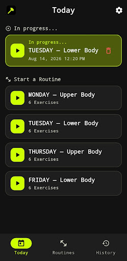
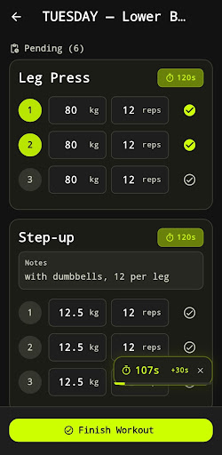
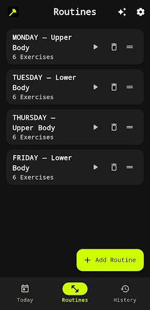
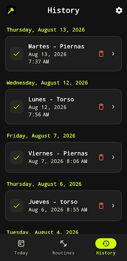
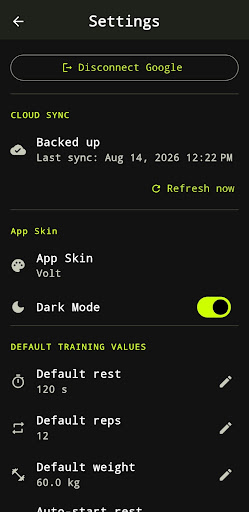

# MuscleUp

Registro de entrenamientos para Android: simple, sin anuncios, sin suscripción y sin analítica.
Funciona completamente sin conexión; la sincronización en la nube es opcional.

[](https://play.google.com/store/apps/details?id=com.arielsoriano.muscleup)

## Por qué la hice

Buscaba una app para anotar mis entrenamientos y todas tenían anuncios, pedían suscripción
o estaban llenas de funciones que no usaba. Quería algo simple: armar mis rutinas, registrar
series y pesos, y ver mi progreso. Como no la encontré, la construí.

## Capturas

| Hoy | Entrenamiento activo | Rutinas | Historial | Ajustes |
|-----|----------------------|---------|-----------|---------|
|  |  |  |  |  |

## Funciones

- **Rutinas a medida**: series con hasta dos objetivos (peso × repeticiones, distancia × tiempo, nivel, inclinación…), en kg o lb.
- **Entrenamiento guiado**: registro de cada serie frente a su objetivo y temporizador de descanso flotante con inicio automático.
- **Historial y progreso**: calendario semanal, varias sesiones por día y evolución de cada ejercicio.
- **Biblioteca de ejercicios** con categorías y ejercicios personalizados.
- **Importar rutinas desde texto**: la app genera un prompt para pegar junto a tus notas en un asistente de IA y lee el resultado. También exporta rutinas en el mismo formato.
- **13 idiomas**: español, inglés, portugués, alemán, francés, italiano, turco, ruso, polaco, neerlandés, indonesio, vietnamita e hindi.
- **Temas**: 5 paletas de color con modo claro y oscuro.
- **Offline-first**: todo funciona en el dispositivo; la sincronización con la nube se activa al vincular una cuenta de Google.

## Stack

| Área | Tecnología |
|------|------------|
| Framework | Flutter / Dart 3 |
| Estado | flutter_bloc (Cubit) |
| Inyección de dependencias | get_it |
| Navegación | go_router |
| Base de datos local | Drift (SQLite) |
| Modelos inmutables | Freezed |
| Nube (opcional) | Firebase Auth (anónimo + Google) y Cloud Firestore |
| Temas | flex_color_scheme |
| Localización | ARB / intl con plurales ICU |
| Tests | flutter_test, fake_cloud_firestore |

## Arquitectura

Clean Architecture organizada por funcionalidad:

```
lib/
├── core/            # DI, router, tema, localización, errores, catálogo de ejercicios
└── features/
    ├── workout/     # rutinas, sesiones, registro, sincronización, import/export
    │   ├── domain/        # entidades, contratos de repositorio, casos de uso
    │   ├── data/          # Drift, DTOs, repositorios, motor de sincronización
    │   └── presentation/  # Cubits, páginas, widgets
    ├── auth/        # sesión anónima y vinculación con Google
    └── settings/    # preferencias, valores por defecto de entrenamiento
```

**Algunos puntos destacados**

- **Offline-first con patrón outbox**: cada cambio se guarda en SQLite y se encola. Un motor de sincronización lo sube a Firestore, descarga los cambios remotos y resuelve conflictos por *last-write-wins* con marcas de borrado.
- **Historial inmutable**: las sesiones guardan una copia del nombre de la rutina, así que editar o borrar una rutina no altera el pasado.
- **Nombres de ejercicio independientes del idioma**: las rutinas guardan una referencia canónica y la traducen al mostrarla, de modo que una rutina creada en español se lee en alemán.
- **Migraciones de esquema idempotentes y testeadas** (v1 → v6).

Más detalle en [ARCHITECTURE.md](ARCHITECTURE.md).

## Cómo ejecutarla

Requisitos: Flutter estable (probado con 3.44) y Android SDK.

```bash
git clone https://github.com/arielsoriano/muscleup.git
cd muscleup
flutter pub get
flutter run
```

No hace falta configurar nada más: sin Firebase la app funciona en modo solo local.

El código generado (Drift, Freezed y traducciones) está incluido en el repositorio. Solo hay que regenerarlo al modificar sus fuentes:

```bash
dart run build_runner build --delete-conflicting-outputs   # tras tocar tablas Drift o clases @freezed
flutter gen-l10n                                           # tras tocar lib/l10n/app_*.arb
```

### Sincronización en la nube (opcional)

El repositorio no incluye credenciales de Firebase. Si `android/app/google-services.json` no existe, el plugin de Google Services no se aplica y la app compila sin sincronización. Para activarla:

1. Crea un proyecto en Firebase y añade una app Android con el paquete `com.arielsoriano.muscleup` (o cambia el `applicationId`).
2. Activa en Authentication los proveedores *Anónimo* y *Google*, y registra la huella SHA‑1 de tu keystore de debug (`cd android && ./gradlew signingReport`).
3. Descarga `google-services.json` en `android/app/`.
4. Crea Cloud Firestore y despliega las reglas de `firebase/firestore.rules`.

### Build de release

`flutter build apk --release` funciona sin configuración: si no existe `android/key.properties`, el APK se firma con la clave de debug. Sirve para instalarlo y probarlo, pero no para publicarlo.

Para firmar con tu propia clave, crea `android/key.properties` con `storeFile` (ruta relativa a `android/app/`), `storePassword`, `keyAlias` y `keyPassword`. Nunca lo subas al repositorio: ya está en `.gitignore`.

### Tests y análisis

```bash
flutter analyze
flutter test
```

## Privacidad

Sin anuncios, sin analítica y sin rastreo. Los datos viven en tu dispositivo y solo se suben a la nube si vinculas una cuenta de Google.
[Política de privacidad](docs/privacy-policy.html) · [Eliminación de cuenta](docs/account-deletion.html)

## Licencia

[GPL v3](LICENSE)
